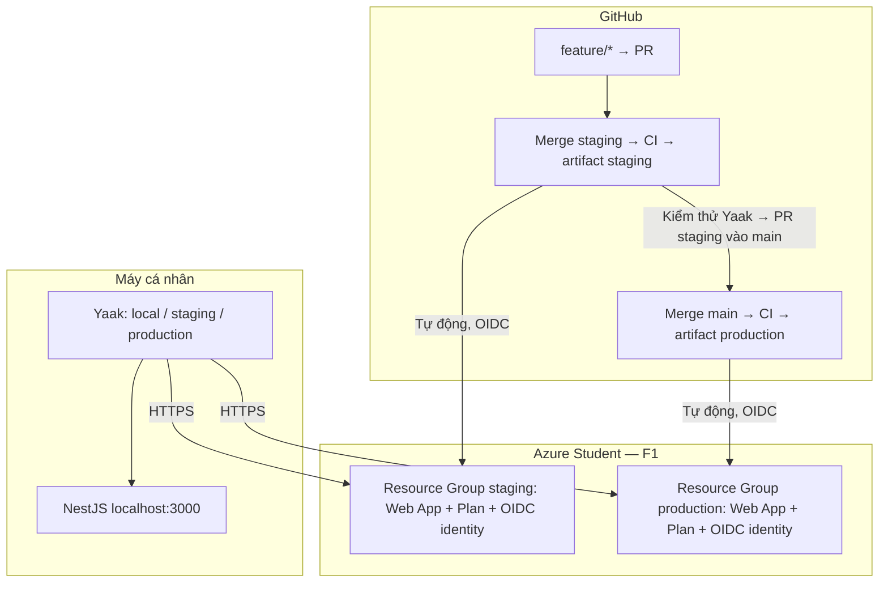

# Triển khai NestJS lên Azure và GitHub CI/CD

Hướng dẫn thực hành: local → staging → production, dùng Yaak thay frontend. Thuật ngữ được ghi theo dạng tiếng Việt (English). [Plan và sơ đồ tổng thể](../plans/azure-env-deploy-ci-cd.md).

## 1. Kiến trúc và trách nhiệm

- NestJS nhận HTTP, kiểm tra cấu hình và trả JSON.
- Azure Web App chạy Node.js 22; App Service Plan F1 quy định tài nguyên.
- Hai Resource Group tách vòng đời staging và production. Hai Web App không dùng deployment slot.
- GitHub Actions kiểm tra mã, đóng gói trên Linux và triển khai qua danh tính liên kết (OIDC).
- Yaak dùng chung request, thay `baseUrl` theo môi trường.



F1 dành cho học/dev/test, có quota và có thể ngủ khi không dùng; không có cam kết sẵn sàng của production thật. Không nâng cấp gói để né lỗi quota. Trước khi tạo, xem credit, ngày hết hạn và quyền sử dụng trong subscription Student thực tế. [Gói App Service](https://learn.microsoft.com/en-us/azure/app-service/overview-hosting-plans).

## 2. Nhóm A — Công cụ và cấu hình local

### Bước 1: Chọn tài khoản đúng

```bash
az login
az account list --query '[].{name:name,state:state}' -o table
az account show --query '{name:name,state:state}' -o json
gh auth status
```

Nếu có nhiều subscription, dùng `az account set --subscription <subscription-id>` trước bước tạo tài nguyên. Không đưa token hoặc `.env` lên GitHub.

Trong Portal: **Subscriptions → Azure for Students** để xem credit/quota; **Cost Management → Budgets → Add** để tạo ngân sách với thông báo tại 50%, 80%, 100%. Chọn số tiền theo credit còn lại, thêm email của bạn. Budget chỉ cảnh báo, không tự dừng tài nguyên. F1 là compute miễn phí nhưng không suy ra mọi dịch vụ Azure đều miễn phí.

### Bước 2: Khớp phiên bản Node.js và pnpm

Repo dùng Node.js 22 (tối thiểu 22.12) và pnpm 12.15.0. Chọn Node 22 bằng công cụ quản lý phiên bản đang dùng; `.node-version` là đầu vào của CI.

```bash
node --version
pnpm --version
pnpm install --frozen-lockfile
cp .env.example .env
pnpm start:dev
```

Nếu chưa có pnpm: cài `pnpm@12.15.0` bằng npm trong Node 22. Khi chủ động thay dependency/package manager, chạy `pnpm install` và review lockfile trước commit; CI không tự sửa lockfile.

### Bước 3: Hiểu các biến môi trường

| Biến | Local | Staging | Production |
|---|---|---|---|
| `APP_ENV` | `local` | `staging` | `production` |
| `NODE_ENV` | `development` | `production` | `production` |
| `PORT` | `3000` | Azure cấp | Azure cấp |

Local nạp `.env` bằng Node.js; biến đã cấp cho tiến trình được ưu tiên. Azure dùng **Web App → Settings → Environment variables**, không upload `.env`. Cả staging và production dùng chế độ tối ưu `NODE_ENV=production`.

[ConfigService](../../src/config/config.service.ts) từ chối môi trường không hỗ trợ, cổng ngoài 1–65535 và cloud chạy sai `NODE_ENV`. [main.ts](../../src/main.ts) nghe trên `0.0.0.0`, bật dừng có kiểm soát (graceful shutdown).

### Bước 4: Kiểm tra ứng dụng

```bash
pnpm format:check
pnpm lint
pnpm typecheck
pnpm test
pnpm test:scripts
pnpm test:e2e
pnpm build
pnpm start:prod
```

Ở terminal khác:

```bash
curl --fail-with-body http://localhost:3000/health
curl --fail-with-body http://localhost:3000/version
curl -i http://localhost:3000/missing
```

Kỳ vọng: health `200` với `{"status":"ok"}`; version `200` với `appEnv=local` và commit SHA của lần build; đường dẫn lạ `404`. Chế độ watch khi chưa build có thể trả `commitSha=local`. Build tạo `build-info.json` ngoài Git; cloud thiếu/sai metadata sẽ không khởi động. `/health` chưa kiểm tra database vì bài lab chưa có database.

## 3. Nhóm B — Thiết lập Yaak

### Bước 5: Nhập bộ request

1. Mở Yaak, tạo workspace `AEMI Backend`.
2. Dùng chức năng nhập dữ liệu (Import), chọn [OpenAPI](../../api/yaak/openapi.yml). Yaak hỗ trợ nhập OpenAPI; nếu phiên bản giao diện khác, nhập từng lệnh curl ở trên.
3. Tạo thư mục `Health`, giữ request `GET /health`, `GET /version`; thêm `GET /missing`.
4. Tạo ba môi trường con (sub-environment): `local`, `staging`, `production`.
5. Mỗi môi trường có biến `baseUrl`; giá trị là URL trong bảng dưới.
6. Trong từng URL, chèn biến `baseUrl` bằng trình chọn biến của Yaak, rồi nối `/health`, `/version` hoặc `/missing`. Không nhân bản request theo môi trường.
7. Đổi màu: local xanh, staging vàng, production đỏ; kiểm tra môi trường đang chọn trước khi gửi.

| Môi trường | `baseUrl` |
|---|---|
| local | `http://localhost:3000` |
| staging | `https://aemi-be-21550022-staging.azurewebsites.net` |
| production | `https://aemi-be-21550022-production.azurewebsites.net` |

Hostname ở đây phải được đối chiếu với `defaultHostName` của app đã tạo; Azure có thể cấp tên khác trong triển khai mới. Đặt thêm biến `expectedCommitSha` nếu muốn ghi nhớ bản đang kiểm tra. Không để access token vào tệp đồng bộ Git. API hiện không cần xác thực.

### Bước 6: Kiểm tra theo môi trường

- `GET /health`: `200`, `status=ok`, `Cache-Control: no-store`.
- `GET /version`: `appEnv` đúng môi trường; `commitSha` khớp workflow triển khai mới nhất.
- `GET /missing`: `404`.
- Nếu app ngủ, gửi lại sau vài giây; không mặc định timeout lần đầu là mã bị lỗi.

Yaak desktop không bị chính sách CORS của trình duyệt. Chỉ thêm CORS khi có frontend và biết origin được phép. [Biến môi trường Yaak](https://yaak.app/docs/templating/environments-and-variables), [nhập và đồng bộ workspace](https://yaak.app/docs/collaboration).

## 4. Nhóm C — Tạo Azure và OIDC

### Bước 7: Tạo repository public

Repository của bài lab: <https://github.com/21550022/aemi-be-nest>. Với repository mới, dùng `gh repo create OWNER/REPO --public`, kiểm tra secrets trước push. Chạy các lệnh tiếp theo ở thư mục gốc repo; `gh` và `az` phải đăng nhập.

### Bước 8: Kiểm tra runtime và region

```bash
az webapp list-runtimes --os linux
az appservice list-locations --sku F1 --linux-workers-enabled -o table
```

Chọn Southeast Asia khi subscription cho phép. Script sau chỉ tạo F1, dừng nếu app đã có dùng plan khác hoặc plan cùng tên là trả phí.

### Bước 9: Tạo staging rồi production

[setup-azure.py](../../scripts/setup-azure.py) thực hiện tuần tự: Resource Group → plan F1 → Web App Node 22 → cấu hình → managed identity → federated credential → role trên Web App → GitHub Environment và variables.

```bash
python3 scripts/setup-azure.py \
  --environment staging \
  --repo 21550022/aemi-be-nest \
  --app-name aemi-be-21550022-staging

python3 scripts/setup-azure.py \
  --environment production \
  --repo 21550022/aemi-be-nest \
  --app-name aemi-be-21550022-production
```

Tên Web App phải duy nhất toàn cục. Nếu dùng tài khoản/repo khác, thay repo và cả tên app. Quota F1 lỗi thì dừng, xem Usage + quotas hoặc chọn region được phép; không đổi SKU trả phí tự động.

Script không gán quyền toàn subscription cho GitHub. Người bootstrap cần quyền tạo tài nguyên/identity và role assignment. OIDC cho phép runner nhận token ngắn hạn, không lưu client secret hoặc publish profile. Hai danh tính có role `Website Contributor` trên đúng Web App tương ứng.

| GitHub Environment | Nhánh được deploy | Subject của federated credential |
|---|---|---|
| staging | `staging` | `repo:21550022/aemi-be-nest:environment:staging` |
| production | `main` | `repo:21550022/aemi-be-nest:environment:production` |

Mỗi Environment có variables: `AZURE_CLIENT_ID`, `AZURE_TENANT_ID`, `AZURE_SUBSCRIPTION_ID`, `AZURE_WEBAPP_NAME`, `AZURE_BASE_URL`. Đây là định danh/cấu hình, không phải mật khẩu. Không bật required reviewers vì yêu cầu là tự deploy sau merge.

Trong Portal, kiểm tra từng Web App:

- Runtime `NODE|22-lts`, startup command `node dist/main.js`.
- `APP_ENV` tương ứng; `NODE_ENV=production`.
- `SCM_DO_BUILD_DURING_DEPLOYMENT=false`, `ENABLE_ORYX_BUILD=false`.
- HTTPS Only bật, TLS tối thiểu 1.2, FTP và basic publishing authentication tắt.
- Không đặt `PORT` cố định, không bật Always On trên F1.

### Bước 10: Hiểu artifact và triển khai thủ công

Build trên Linux, đóng gói dependency production với bố cục hoisted. [package-azure.mjs](../../scripts/package-azure.mjs) tạo `.artifacts/app.zip`, checksum và metadata; ZIP chỉ gồm `dist`, `node_modules`, `package.json`, `build-info.json`.

```bash
pnpm build
pnpm package:azure
pnpm test:package
az webapp deploy \
  --resource-group rg-aemi-be-staging \
  --name aemi-be-21550022-staging \
  --src-path .artifacts/app.zip --type zip
```

Đây là bài thực hành thủ công trước CI/CD; không chạy deploy thủ công chồng với pipeline. macOS chỉ được kiểm tra đóng gói bằng `ALLOW_LOCAL_PACKAGE=1 pnpm package:azure`; gói chạy local này không thay cho artifact Linux đưa lên cloud.

## 5. Nhóm D — CI/CD theo nhánh

### Bước 11: Luồng làm việc

```text
feature/* → PR staging → CI đạt → merge staging → tự deploy staging
                                               ↓ kiểm thử Yaak
                              PR staging → main → CI đạt → merge main
                                                                  ↓
                                                        tự deploy production
```

Không deploy khi chỉ mở PR. Sự kiện `push` sau merge vào nhánh đích mới cho phép CD. Vì push trực tiếp cũng kích hoạt cùng sự kiện, cần bảo vệ cả hai nhánh.

Trong **Repository → Settings → Branches**, thêm protection cho `main` và `staging`:

- Require a pull request before merging; nếu làm một mình, không yêu cầu reviewer mà mình không có.
- Require status checks: `Quality checks`, và nhánh phải cập nhật trước merge.
- Áp dụng quy tắc cả cho admin; chặn force push và xóa nhánh.

Có thể áp dụng cùng cấu hình bằng script:

```bash
python3 scripts/protect-branches.py --repo 21550022/aemi-be-nest
```

Không sửa workflow trên nhánh production để bỏ các kiểm tra. Khi hotfix trực tiếp qua PR vào main, đồng bộ main về staging sau đó bằng PR để tránh mất bản sửa.

### Bước 12: Hiểu workflow

[ci-cd.yml](../../.github/workflows/ci-cd.yml):

1. `pull_request` vào main/staging: cài frozen lockfile → format → lint → typecheck → unit test → script test → e2e → build.
2. `push` main/staging: chạy lại các bước trên chính commit đã merge, tạo ZIP trên Ubuntu, kiểm tra ZIP chạy được, lưu artifact 30 ngày.
3. Chỉ sau khi job kiểm tra thành công, job deployment nhận OIDC và tải artifact cùng run.
4. Xác minh SHA, branch, run ID, checksum trước deploy.
5. Deploy đúng Web App theo nhánh.
6. Retry health/version; yêu cầu đúng `appEnv` và SHA. Tóm tắt URL/SHA/run ID trong Actions summary.

PR không có Azure OIDC. `id-token: write` chỉ cấp cho job triển khai. Staging và production build riêng; merge có thể sinh SHA mới nên không yêu cầu hai môi trường có cùng SHA.

Concurrency group riêng cho từng môi trường, `cancel-in-progress: false`, `queue: max`: không cắt deployment đang chạy và không chạy hai deployment cùng môi trường đồng thời. Workflow rollback dùng chung nhóm production. Hàng đợi không thay thế kiểm thử; nếu nhiều PR đang chờ, kiểm tra commit thực tế trong summary và `/version`.

### Bước 13: Kiểm chứng bằng PR thật

1. Tạo nhánh feature từ staging, sửa mã và mở PR vào staging.
2. Xem `Quality checks`; khi PR chưa merge, Azure chưa nhận bản này.
3. Merge PR; xem run push staging, xác nhận chỉ staging deploy.
4. Chọn staging trong Yaak, kiểm tra health/version/404.
5. Mở PR staging vào main; kiểm tra diff và CI, rồi merge.
6. Xem run push main, xác nhận chỉ production deploy.
7. Chọn production trong Yaak, đối chiếu SHA trên main.

Có thể dùng CLI:

```bash
gh run list --workflow ci-cd.yml
gh run view RUN_ID --log-failed
node scripts/smoke.mjs https://aemi-be-21550022-staging.azurewebsites.net staging FULL_SHA
node scripts/smoke.mjs https://aemi-be-21550022-production.azurewebsites.net production FULL_SHA
```

Smoke retry tối đa 30 lần, cách 5 giây; mỗi HTTP request timeout 10 giây. Thời gian tổng có thể dài hơn 150 giây khi có timeout. Không chỉ kiểm tra HTTP 200: version sai cũng thất bại.

### Bước 14: Khôi phục phiên bản (rollback)

[rollback.yml](../../.github/workflows/rollback.yml) chỉ chạy thủ công trên main. Chọn một **CI run push main thành công**, artifact chưa hết hạn:

```bash
gh workflow run rollback.yml --ref main -f run_id=PREVIOUS_SUCCESSFUL_MAIN_RUN_ID
```

Workflow kiểm tra repo, workflow path, sự kiện, nhánh, trạng thái thành công, artifact còn tồn tại và checksum; tải lại artifact cũ, deploy và smoke test. Không build lại mã cũ. Nếu chọn run staging hoặc run CI thất bại, phải bị từ chối trước Azure login/deploy.

F1 không có slot swap; rollback có thể gián đoạn. Sau khôi phục, revert lỗi trên main qua PR và đồng bộ về staging. Nếu commit revert đã tự deploy, không chạy rollback cũ sau đó mà không kiểm tra lại thứ tự mong muốn.

## 6. Lỗi thường gặp và cách xác minh

| Hiện tượng | Kiểm tra và xử lý |
|---|---|
| Frozen lockfile lỗi | Dùng đúng pnpm trong `packageManager`; cập nhật lockfile chủ động, commit cả manifest và lockfile |
| CI đỏ, không deploy | Xem job `Quality checks`, sửa lỗi rồi push lại PR |
| OIDC lỗi subject | Kiểm tra repo + tên Environment; job có Environment thì subject không phải nhánh |
| Azure 403 | Kiểm tra đúng managed identity, role trên đúng Web App; chờ role propagation rồi chạy lại |
| App 502/503 | Deployment log, Log Stream, startup `node dist/main.js`, metadata và dependency trong ZIP |
| Sai version | Kiểm tra hostname/environment, SHA artifact/run; chờ deploy hoàn tất rồi thử lại |
| F1 ngủ/quota | Retry có giới hạn, xem quota; không tự nâng gói |
| Rollback thiếu artifact | Chọn run còn trong 30 ngày; không tuyên bố rollback thành công khi artifact không còn |

Trong Portal: **Deployment Center → Logs** cho deployment; **Monitoring → Log stream** cho startup/runtime. Nếu cần, bật filesystem application logging trong App Service logs; không tạo dịch vụ log trả phí tự động. Không ghi tokens hoặc giá trị cấu hình bí mật vào log.

## 7. Bằng chứng và dọn tài nguyên

Trạng thái triển khai thực tế được ghi riêng trong [deployment-verification.md](deployment-verification.md), gồm run/PR/URL và giới hạn còn lại. Tệp cấu hình, workflow tồn tại hoặc build local đạt không tự chứng minh cloud chạy được.

Sau bài học, chỉ khi muốn xóa toàn bộ hai môi trường lab, chạy:

```bash
az group delete --name rg-aemi-be-staging
az group delete --name rg-aemi-be-production
```

CLI yêu cầu xác nhận; thao tác xóa Web App, plan và identity trong nhóm. GitHub Environments vẫn còn, nên xóa cấu hình OIDC/variables không còn dùng và tắt workflow nếu dừng bài học. Không chạy lệnh dọn khi còn muốn giữ API online.

## Nguồn chính thức

- [Azure Node.js configuration](https://learn.microsoft.com/en-us/azure/app-service/configure-language-nodejs)
- [Azure GitHub Actions deployment](https://learn.microsoft.com/en-us/azure/app-service/deploy-github-actions)
- [GitHub OIDC with Azure](https://docs.github.com/en/actions/how-tos/security-for-github-actions/security-hardening-your-deployments/configuring-openid-connect-in-azure)
- [GitHub concurrency](https://docs.github.com/en/actions/how-tos/write-workflows/choose-when-workflows-run/control-workflow-concurrency)
- [Yaak environments](https://yaak.app/docs/templating/environments-and-variables)
