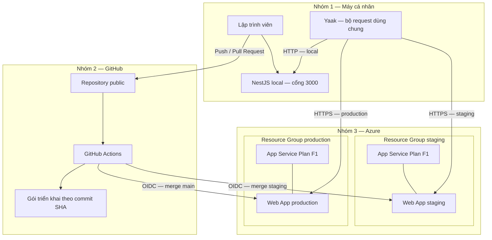
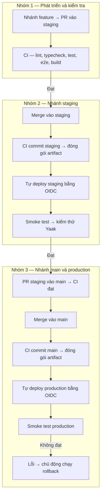
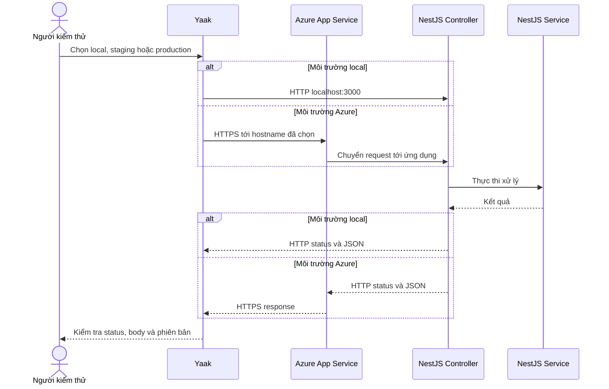
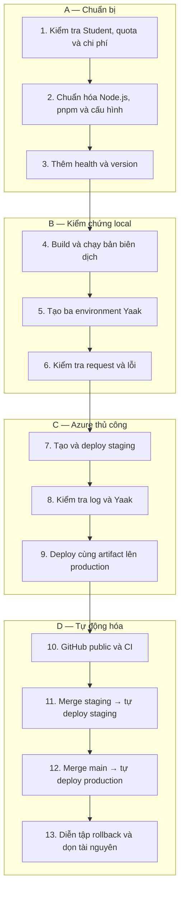

# Kế hoạch triển khai NestJS lên Azure và thiết lập GitHub CI/CD

## 1. Mục tiêu và kiến trúc đã chốt

Triển khai theo hướng **làm thủ công để hiểu trước → tự động hóa bằng GitHub Actions**.

Các lựa chọn đã thống nhất:

- Nền tảng: **Azure App Service trên Linux**, chạy Node.js trực tiếp.
- Hai Web App gói **F1**: `staging` và `production`.
- `dev` chạy trên máy cá nhân.
- Kiểm thử bằng **Yaak**, chưa cần Next.js.
- Kho mã nguồn (repository) GitHub **public**.
- Hợp nhất (merge) vào `staging` tự triển khai staging sau khi CI đạt.
- Sau khi kiểm thử bằng Yaak, mở PR từ `staging` vào `main`; merge vào `main` tự triển khai production sau khi CI đạt.
- Mỗi nhánh build artifact từ commit của chính nhánh đó; không yêu cầu dùng chung artifact giữa hai nhánh.
- Chưa triển khai database, Docker, tên miền riêng hoặc đăng nhập.

**“Production” trong kế hoạch này là môi trường thực hành quy trình phát hành.** F1 có giới hạn tài nguyên và quota, không phải cấu hình cam kết phục vụ người dùng thật. Quyền tạo tài nguyên vẫn cần kiểm tra trong subscription Student thực tế. [Các gói App Service](https://learn.microsoft.com/en-us/azure/app-service/overview-hosting-plans)

### Sơ đồ kiến trúc (architecture diagram)



**Phân biệt các thành phần:**

| Thành phần | Trách nhiệm |
|---|---|
| Web App | Chạy mã NestJS, nhận HTTP, giữ cấu hình môi trường |
| App Service Plan | Xác định loại tài nguyên và giới hạn chạy ứng dụng |
| Resource Group | Gom tài nguyên để quản lý vòng đời và dọn dẹp |
| GitHub Actions | Kiểm tra, đóng gói và triển khai |
| Gói triển khai (artifact) | Bản ứng dụng đã build, gắn với một commit cụ thể |
| Yaak | Gửi cùng bộ request tới ba môi trường |

Hai môi trường Azure là **hai Web App riêng**, không dùng khe triển khai (deployment slot). Deployment slot yêu cầu gói hỗ trợ cao hơn F1. [Tài liệu deployment slot](https://azure-samples.github.io/app-service-labs/docs/deployment-and-cicd/deployment-slots/)

## 2. Các bước thực hiện và giải thích

### Nhóm A — Chuẩn bị tài khoản và ứng dụng

**Bước 1 — Kiểm tra Azure Student**

Trong Azure Portal:

1. Mở **Subscriptions**, kiểm tra subscription đang hoạt động.
2. Xem số dư credit và ngày hết hạn.
3. Kiểm tra quyền tạo App Service trên Linux với F1.
4. Chọn region hỗ trợ F1; ưu tiên Southeast Asia nếu subscription cho phép.
5. Tạo cảnh báo ngân sách (budget alert) theo số dư và mức chi tiêu mong muốn.

Không mặc định mọi tài khoản Student đều còn nguyên credit. Cảnh báo ngân sách cũng không tự động dừng tài nguyên khi chạm ngưỡng.

**Kết quả:** biết subscription, region, quota và giới hạn chi phí trước khi tạo tài nguyên.

**Bước 2 — Chuẩn bị công cụ**

Cài hoặc kiểm tra:

- Git.
- Azure CLI.
- Node.js 22, tối thiểu `22.12`, dùng cùng dòng phiên bản cho local, CI và Azure.
- pnpm, khóa phiên bản cụ thể trong trường `packageManager`.
- Yaak.

Các lệnh kiểm tra:

```bash
node --version
pnpm --version
git --version
az version
az login
az account show
az webapp list-runtimes --os linux
```

Trước khi tạo Web App, xác nhận runtime Node.js đã chọn có trong danh sách Azure. Node.js 22 đã được App Service hỗ trợ trên Linux. [Thông báo chính thức](https://azure.github.io/AppService/2025/02/18/Node-22.html)

**Bước 3 — Chuẩn hóa cấu hình ứng dụng**

Repo hiện đã có build, lint, unit test và e2e; cần bổ sung:

- Khóa Node.js và pnpm.
- Tệp mẫu `.env.example`, không chứa bí mật.
- Cơ chế nạp và kiểm tra biến môi trường.
- Tách môi trường ứng dụng (`APP_ENV`) khỏi chế độ Node.js (`NODE_ENV`).
- Khởi động rõ ràng bằng `node dist/main.js`.
- Kiểm tra ứng dụng lắng nghe cổng Azure cấp qua `PORT`.
- Bật dừng ứng dụng có kiểm soát (graceful shutdown).

Không dùng script `pnpm deploy` hiện có làm lệnh triển khai Azure: script này đang gọi `nest deploy`, không phải quy trình Azure trong kế hoạch.

| Biến | Local | Staging | Production |
|---|---|---|---|
| `APP_ENV` | `local` | `staging` | `production` |
| `NODE_ENV` | `development` | `production` | `production` |
| `PORT` | `3000` | Do Azure cấp | Do Azure cấp |
| Nơi cấu hình | `.env` local | App Service settings | App Service settings |

`NODE_ENV=production` trên staging giúp kiểm thử ứng dụng trong chế độ chạy tương tự production.

**Bước 4 — Thêm API phục vụ kiểm chứng**

Giữ cấu trúc NestJS đơn giản: module → controller → service.

Bổ sung hai API:

| API | Mục đích | Kết quả |
|---|---|---|
| `GET /health` | Kiểm tra tiến trình xử lý được HTTP | `200`, `{"status":"ok"}` |
| `GET /version` | Xác nhận môi trường và bản triển khai | `200`, gồm `appEnv`, `commitSha` |

`commitSha` được đóng vào artifact trong lúc build. `appEnv` đọc từ cấu hình lúc chạy.

Không trả về cấu hình nội bộ hoặc credentials. Vì chưa có database, `/health` chưa chứng minh khả năng kết nối database.

**Kết quả:** có cách xác nhận “app đang chạy” và “đúng bản cần chạy”.

### Nhóm B — Kiểm thử local bằng Yaak

**Bước 5 — Chạy kiểm tra nền**

```bash
pnpm install --frozen-lockfile
pnpm lint
pnpm exec tsc --noEmit
pnpm test
pnpm test:e2e
pnpm build
pnpm start:prod
```

Chạy bản biên dịch ở local trước để phát hiện lỗi ESM, đường dẫn import hoặc thiếu dependency mà chế độ phát triển có thể chưa bộc lộ.

**Bước 6 — Tạo workspace Yaak**

Tạo workspace `AEMI Backend`, gồm:

- Thư mục `Health`.
- Request `GET /health`.
- Request `GET /version`.
- Request tới đường dẫn không tồn tại để kiểm tra `404`.

Tạo ba môi trường (environment):

| Environment | `baseUrl` |
|---|---|
| `local` | `http://localhost:3000` |
| `staging` | URL HTTPS thực tế của Web App staging |
| `production` | URL HTTPS thực tế của Web App production |

Trong URL request, chèn biến `baseUrl` bằng trình chọn biến của Yaak rồi nối `/health` hoặc `/version`. Không nhập lại URL cho từng bản request. Yaak hỗ trợ biến dùng chung và biến theo môi trường. [Hướng dẫn Yaak](https://yaak.app/docs/templating/environments-and-variables)

Gán màu dễ phân biệt, đặc biệt production dùng màu đỏ. Đồng bộ collection và cấu hình không chứa bí mật vào Git nếu dùng tính năng đồng bộ thư mục (directory sync).

**Kết quả:** chuyển environment là kiểm thử được cùng một hành vi ở nơi khác.

### Nhóm C — Triển khai thủ công lên Azure

**Bước 7 — Tạo staging trước**

Tạo tài nguyên theo thứ tự:

1. Resource Group staging.
2. App Service Plan Linux F1.
3. Web App staging, chọn Node.js runtime đã xác nhận.
4. Bật chỉ dùng HTTPS (HTTPS Only).
5. Đặt `APP_ENV=staging`, `NODE_ENV=production`.
6. Đặt lệnh khởi động `node dist/main.js`.

Tên Web App phải duy nhất toàn cục. Lưu hostname Azure thực tế trả về để điền vào Yaak; không tự suy đoán hostname.

**Bước 8 — Đóng gói ứng dụng**

Artifact cần chứa:

```text
dist/
node_modules/
package.json
```

Quy tắc đóng gói:

- Build và cài dependency trên runner Linux tương thích Azure.
- Chỉ đưa dependency cần lúc chạy (production dependencies).
- Dùng bố cục `node_modules` dạng hoisted trong thư mục đóng gói riêng để tránh liên kết pnpm trỏ ra ngoài gói.
- Không đưa `.env`, mã kiểm thử hoặc credentials vào ZIP.
- Không build lại trên Azure; cấu hình rõ việc tắt remote build.
- Chạy thử chính nội dung gói trước khi tải lên.

Chỉ tải `dist/` sẽ thiếu dependency của NestJS. Đưa nguyên `node_modules` từ macOS lên Linux có thể gây lỗi với dependency có thành phần native.

**Bước 9 — Deploy và kiểm tra staging**

Dùng Azure CLI triển khai ZIP đã chuẩn bị, sau đó:

1. Kiểm tra trạng thái triển khai.
2. Mở Log Stream để xem lỗi khởi động.
3. Gọi `/health`.
4. Gọi `/version`, đối chiếu commit và `appEnv`.
5. Chạy bộ request Yaak với environment staging.
6. Khởi động lại Web App, kiểm tra lại.

F1 có thể khởi động chậm sau thời gian không hoạt động. Kiểm tra nhanh (smoke test) cần retry có giới hạn, tránh kết luận lỗi ngay ở request đầu tiên.

Lệnh kiểm chứng tương đương Yaak:

```bash
curl --fail-with-body "$STAGING_BASE_URL/health"
curl --fail-with-body "$STAGING_BASE_URL/version"
```

**Bước 10 — Tạo production**

Lặp lại cấu hình với Resource Group và Web App production riêng.

Trong bài thực hành thủ công ban đầu, triển khai cùng artifact đã kiểm tra staging để hiểu cách tách cấu hình môi trường. Khi bật CI/CD ở phần 3, mỗi nhánh sẽ build và triển khai artifact riêng từ commit đã merge vào nhánh tương ứng.

**Mốc hoàn thành:** cả hai môi trường trả đúng health, môi trường và commit SHA.

## 3. Thiết lập GitHub CI/CD

### Sơ đồ luồng CI/CD



**Bước 11 — Tạo repo public**

- Kiểm tra secrets trước lần push đầu.
- Thêm Git remote, tạo hai nhánh lâu dài (long-lived branches) `main` và `staging`.
- Bật GitHub Actions.
- Bảo vệ cả `main` và `staging`: yêu cầu Pull Request, CI đạt và chặn push trực tiếp.
- Luồng thông thường: `feature/*` → PR vào `staging` → kiểm thử Yaak → PR `staging` vào `main`.
- Sau khi merge vào `main`, đồng bộ thay đổi ngược về `staging` khi có khác biệt; xử lý xung đột qua PR.
- Nếu làm một mình, không đặt số reviewer khiến chính mình không thể merge.

**Bước 12 — Tạo workflow CI**

Workflow chạy khi:

- Mở hoặc cập nhật PR vào `staging` hoặc `main`: chỉ kiểm tra, không deploy.
- Push vào `staging` hoặc `main` sau khi merge PR: kiểm tra rồi deploy môi trường tương ứng.

Sự kiện triển khai là `push` trên nhánh đích, không dùng `pull_request.closed`. Quy tắc bảo vệ nhánh ngăn push trực tiếp đi vòng quy trình review.

Các bước:

1. Checkout.
2. Cài Node.js và pnpm đã khóa phiên bản.
3. Cài dependency bằng frozen lockfile.
4. Lint và kiểm tra kiểu (typecheck).
5. Unit test và e2e.
6. Build.
7. Chỉ với sự kiện push vào `staging` hoặc `main`: đóng gói, kiểm tra gói, lưu artifact cùng nhánh, SHA và checksum.
8. Khi toàn bộ CI đạt, triển khai artifact của chính run đó: `staging` → staging; `main` → production.

Merge có thể tạo SHA mới; vì vậy production build lại từ commit trên `main`. Đối chiếu `/version` với SHA của nhánh đích, không yêu cầu SHA staging và production bằng nhau.

PR không được cấp quyền triển khai Azure.

**Bước 13 — Thiết lập xác thực OIDC**

Dùng liên kết danh tính (OpenID Connect, OIDC) để GitHub nhận thông tin xác thực ngắn hạn từ Azure, thay vì lưu mật khẩu Azure dài hạn. Đây là hướng Microsoft hỗ trợ cho App Service. [Hướng dẫn GitHub Actions trên Azure](https://learn.microsoft.com/en-us/azure/app-service/deploy-github-actions?tabs=openid)

Thiết lập:

- Hai danh tính triển khai riêng: staging và production.
- Quyền triển khai giới hạn trên Web App tương ứng.
- Liên kết tin cậy (federated credential) khớp chính xác repo và ngữ cảnh workflow.
- Tạo GitHub Environment `staging` và `production`, không bật required reviewers cho luồng tự động này.
- Federated credential của mỗi danh tính khớp Environment tương ứng; khi job dùng Environment, subject OIDC là Environment thay vì nhánh.
- Giới hạn nhánh được deploy trong Environment: `staging` chỉ nhận nhánh `staging`, `production` chỉ nhận nhánh `main`.
- Điều kiện job cũng kiểm tra sự kiện `push` và nhánh đích để tránh PR nhận quyền triển khai.
- Job triển khai có `id-token: write`; các job khác không cần quyền này.

Các giá trị cấu hình gồm subscription ID, tenant ID, client ID và tên Web App. Không đưa subscription-wide Contributor vào workflow chỉ để tiện thiết lập.

**Bước 14 — Tự động deploy staging**

Sau CI thành công của sự kiện push trên `staging`:

1. Tải artifact của chính run đó.
2. Đăng nhập Azure bằng OIDC.
3. Deploy staging.
4. Retry `/health` trong thời gian giới hạn.
5. Kiểm tra `/version` đúng commit SHA và `appEnv=staging`.
6. Xuất URL, commit và run ID vào workflow summary.

Dùng nhóm đồng thời (concurrency group) để tránh hai deployment staging chồng nhau. Không ngắt deployment đang chạy chỉ vì có commit mới.

**Bước 15 — Tự động deploy production khi merge main**

Sau khi kiểm thử staging bằng Yaak, mở PR từ `staging` vào `main`. CI trên PR phải đạt trước khi merge. Sau merge, sự kiện push vào `main` chạy CI trên commit thực tế rồi tự triển khai production, không cần bấm phát hành hoặc chờ Environment approval.

Trước khi deploy, workflow phải xác minh:

- Sự kiện là `push`, nhánh là `refs/heads/main`.
- Các bước CI trên commit đó đã thành công.
- Artifact thuộc chính run đó, SHA và checksum khớp metadata.
- Job dùng Environment và danh tính OIDC production.

Sau deploy, retry `/health`, kiểm tra `/version` đúng SHA trên `main` và `appEnv=production`, rồi ghi URL, SHA và run ID vào workflow summary. Nếu smoke test lỗi, đánh dấu deployment thất bại và thực hiện rollback ở bước 16.

Dùng concurrency group riêng cho production, không hủy deployment đang chạy. Staging và production có thể deploy độc lập. Kiểm thử Yaak là bước thực hành trước khi merge PR; pipeline chưa tự xác minh rằng người dùng đã chạy Yaak.

**Bước 16 — Khôi phục phiên bản (rollback)**

Lưu artifact của các bản đã phát hành cùng thời hạn lưu giữ rõ ràng, mặc định 30 ngày.

Khi bản mới lỗi:

1. Chọn CI run thành công trên `main` của bản production tốt trước đó.
2. Chạy workflow phục hồi thủ công.
3. Xác minh nguồn artifact thuộc repo, workflow và nhánh `main`; SHA và checksum phải khớp.
4. Deploy lại production.
5. Kiểm tra health và commit SHA.
6. Revert thay đổi gây lỗi trên `main` qua PR, rồi đồng bộ về `staging` để lần deploy tiếp theo không đưa lỗi trở lại.

Chỉ workflow rollback dùng `workflow_dispatch`; dùng chung concurrency group production và giới hạn chạy từ `main` để không chồng với deployment tự động.

F1 không có slot swap; rollback là triển khai lại và có thể gián đoạn ngắn. Artifact hết hạn cần được phát hiện trước khi bắt đầu deployment.

## 4. Luồng request và thứ tự học

### Sơ đồ luồng gọi API (request flow)



Yaak chạy trên desktop nên không cần bật CORS chỉ để kiểm thử. Khi Next.js xuất hiện, cấu hình CORS theo origin và cách xác thực thực tế.

### Sơ đồ từng bước có gom nhóm



Mỗi nhóm chỉ chuyển tiếp khi nhóm trước đã có kết quả quan sát được. Điều này giúp phân biệt lỗi ứng dụng, lỗi Azure và lỗi workflow.

## 5. Kiểm chứng và tài liệu bàn giao

| Tình huống | Tiêu chí đạt |
|---|---|
| Local | Bản biên dịch khởi động được; health trả `200` |
| Cấu hình | Giá trị môi trường sai làm startup thất bại rõ ràng |
| Staging | Merge `staging` tự deploy; health đạt, version đúng SHA và `staging` |
| Production | Merge `main` tự deploy; version đúng SHA trên `main` và `production` |
| Phân nhánh | Merge `staging` chỉ deploy staging; merge `main` chỉ deploy production |
| PR lỗi | CI thất bại; không triển khai và không được merge |
| PR đạt nhưng chưa merge | Chỉ chạy CI; không triển khai |
| PR từ fork | Không được cấp quyền Azure |
| Run không hợp lệ | Job deploy hoặc rollback từ chối sai nhánh, sự kiện hoặc artifact |
| Khởi động chậm | Retry có giới hạn; hết thời gian thì báo lỗi |
| Hai lần phát hành | Deployment được tuần tự hóa |
| Rollback | Trở lại đúng SHA trước đó; health đạt |
| Secrets | Không xuất hiện trong Git, ZIP hoặc log |

Khi thực hiện, tạo một hướng dẫn Markdown tiếng Việt, thuật ngữ theo dạng **tiếng Việt (English)**, gồm:

- Các bước Portal và Azure CLI, giải thích mục đích từng bước.
- Toàn bộ workflow YAML dùng được.
- Thiết lập Yaak và ví dụ request/curl.
- Các sơ đồ trên.
- Lỗi thường gặp: sai startup command, thiếu dependency, cổng không đúng, OIDC không khớp, quota F1 và artifact hết hạn.
- Cách dọn hai Resource Group sau bài học; giải thích rõ tác động trước khi chạy lệnh xóa.

**Giả định:** đây là bài thực hành trên Student credit, hai Web App F1 không chứa dữ liệu thật. Nếu subscription không cho tạo đủ tài nguyên F1, dừng tại bước kiểm tra quota để điều chỉnh kế hoạch, không tự chuyển sang gói trả phí.

